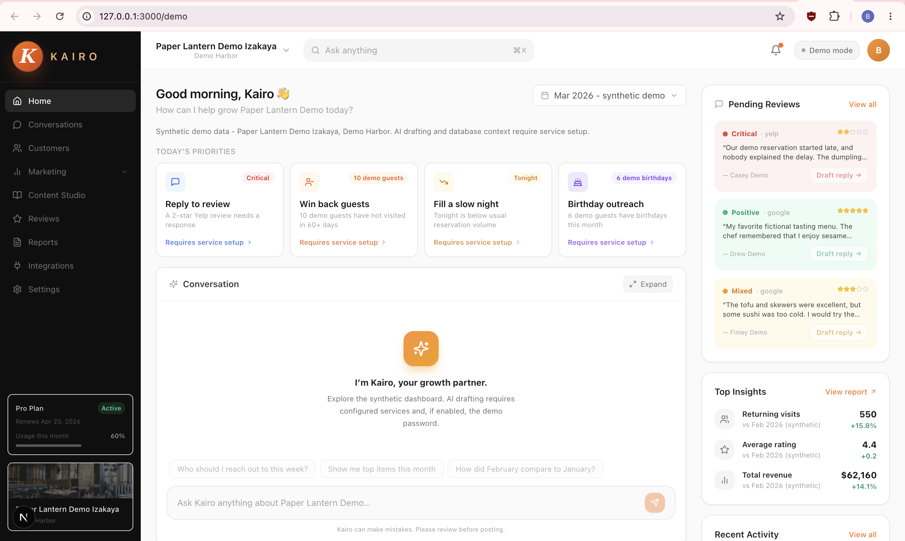
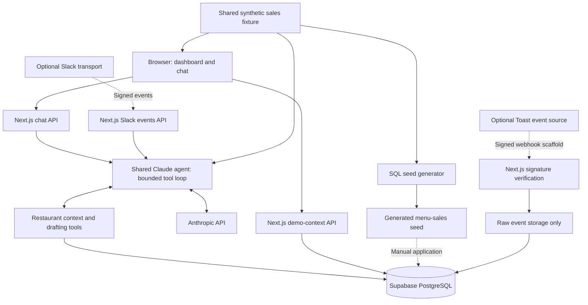

# Kairo

An AI-assisted growth copilot for independent restaurants that turns sales, customer and review context into actionable marketing drafts through a conversational interface.

Built by **Bil Enkhbileg** as a **University of Washington capstone project**, with **Ozora Izakaya** as the real restaurant design partner.

**Public demo:** Paper Lantern Demo Izakaya is fictional. All bundled sales metrics, customers, reviews, contact details and action-history fixtures are synthetic. Ozora attribution describes the design partnership, not the demo data.

## The Problem

Independent restaurant owners have growth opportunities hidden in sales reports, guest records and reviews, but little time to turn that information into marketing. Drafting a promotion or responding thoughtfully to a review competes with running the restaurant.

Kairo brings that context into a conversation so an owner can move from a question to a useful draft without navigating disconnected tools.

## What Kairo Does

- Presents synthetic monthly sales trends and database-backed customer segments in an owner dashboard.
- Answers questions using restaurant context, including recent, lapsed and birthday guests and pending reviews.
- Drafts Instagram captions, hashtags and photo briefs using the restaurant's brand voice.
- Drafts review replies based on the supplied review and rating.
- Supports web chat and optional Slack through the same agent logic.

Generated content remains a **draft for human review**. External publishing and sending are intentionally not implemented: Kairo does not send SMS, publish Instagram posts or automatically respond to reviews. There is no complete approval-and-execution workflow.

## Demo

**Dashboard - `/demo`:** monthly performance, customer opportunities and conversational drafting in one workspace.



**AI drafting workflow:** request an Instagram post or review reply, inspect the generated content and copy it for manual use. Tool-execution summaries show which capabilities were used, not private model reasoning.

<!-- TODO: Add AI drafting workflow screenshot -->

**Focused chat - `/chat`:** a simpler interface for exploring the same owner agent. Live AI responses require configured services.

## How It Works

1. The browser sends conversation history to a Next.js API route, which validates the request and checks the optional shared password.
2. The server resolves the configured restaurant slug. Optional Slack requests resolve restaurant context through the owner's Slack user mapping.
3. A shared Claude agent runs a bounded tool-use loop, with at most six iterations. Tool results and errors feed back into the conversation; completed drafting results can return directly.
4. Context tools read Supabase guest and review records. Drafting tools call Claude with restaurant-specific guidance and attempt to persist structured action records.
5. The interface displays replies, tool summaries and supported draft cards. Sales calculations and sales context come from a shared local synthetic fixture, not live POS synchronization.

## Architecture



Solid arrows represent implemented code paths; dashed arrows identify optional ingress or manual setup. The Toast path is a scaffold: it verifies a signature and stores raw payloads, but does not parse orders, synchronize sales or update customers.

## Key Engineering Decisions

- **One agent, multiple transports.** Web chat and optional Slack reuse business logic, separating transport handling from tool execution.
- **Server-controlled restaurant context.** Web requests use a configured slug rather than a client-supplied tenant identifier. This is context scoping, not complete multi-tenant authorization.
- **Bounded, draft-first tool use.** The iteration limit constrains the loop; the absence of publishing/sending tools avoids irreversible external actions.
- **One synthetic sales source of truth.** Dashboard calculations, Claude sales context and generated SQL derive from the same fixture.
- **Database-backed segmentation and narrow logging.** Guest records drive customer segments. Implemented drafting actions attempt to persist structured input/output records, not a comprehensive or guaranteed audit trail.

## Tech Stack

| Layer | Technology |
|---|---|
| Application | Next.js 15 App Router, React 19, TypeScript |
| Interface | Tailwind CSS, Lucide icons, React Markdown |
| AI | Anthropic SDK and Claude tool use |
| Data | Supabase PostgreSQL, SQL migrations and demo seeds |
| Validation | Zod request and environment schemas |
| Optional transport | Slack Events API and `chat.postMessage` |
| Demo verification | Node.js fixture, calculation and generated-SQL checks |

## What's Implemented

| Capability | Current scope |
|---|---|
| Dashboard and web chat | Implemented demo interfaces; conversation history is held by the client |
| Claude agent | Shared, bounded tool-use loop with restaurant-aware context |
| Instagram and review-reply drafting | Implemented Claude inference; no external publication |
| Customer segmentation | Database-backed snapshot of recent, lapsed and birthday guests |
| Sales demo | Shared synthetic metrics and generated menu-sales SQL |
| Draft action records | Structured persistence attempts for the two implemented drafting tools |
| Slack | Optional implemented transport; requires credentials and owner mapping |
| Toast | Signed-webhook/raw-storage scaffold; no live POS synchronization |
| Lapsed-guest agent tool, win-back SMS and review-fetch tool | Stubs; separate snapshot segmentation works, but these tools are incomplete |
| SMS/email delivery, social publishing, review ingestion and lifecycle automation | Not implemented |
| Owner authentication, approval workflow and tenant RLS policies | Incomplete or not implemented |

Some dashboard sections and controls are placeholders. This is a capstone prototype, not a production-ready multi-tenant service. The shared-password gate is optional, RLS policies are unfinished, and inherited build configuration disables type/lint enforcement.

There is no conventional unit/integration/end-to-end test suite or GitHub Actions configuration. The synthetic-data verifier checks fixture consistency and selected source/seed structures, not live APIs or database migration execution.

## Running Locally

Use **Node.js 20 or later**, a dedicated Supabase demo project and an Anthropic API key.

```bash
npm ci
cp .env.example .env.local
```

Fill in the Supabase URL, anon key, service-role key and Anthropic key locally. Keep server credentials private. The example selects `paper-lantern-demo` and defaults to `claude-sonnet-4-6`; `ANTHROPIC_MODEL` can override the model.

Apply these files in order through the Supabase SQL editor or CLI:

1. `supabase/migrations/0001_initial_schema.sql`
2. `supabase/migrations/0002_menu_sales.sql`
3. `supabase/migrations/0003_menu_sales_seed.sql`
4. `supabase/seed_demo.sql`

Use only a dedicated fictional demo database. Set a strong `KAIRO_CHAT_PASSWORD` and enter it in the interface: the dashboard's snapshot-loading flow expects a password even though the API gate is optional.

```bash
npm run dev
```

Open `/demo` for the dashboard or `/chat` for focused chat at `http://localhost:3000`.

```bash
node scripts/verify-demo-data.mjs
npm run typecheck
npm run build
npm run start
```

Run type checking explicitly: a successful build does not enforce it. The existing `npm run lint` uses the obsolete `next lint` command and needs updating. `npm run db:reset` prints guidance rather than resetting a database.

**Slack and Toast are optional**, not prerequisites for the web demo. See [Slack setup](docs/slack-app-setup.md) and [owner mapping](docs/owner-onboarding.md) for Slack. [Setup notes](docs/setup.md) and the [deployment runbook](docs/deploy-runbook.md) provide deeper operational context; planned integrations described there are not completed features.

## Synthetic Demo Data

[`src/lib/demo/sales.json`](src/lib/demo/sales.json) defines 24 invented menu items across eight categories and January-March 2026. [`sales.ts`](src/lib/demo/sales.ts) derives dashboard sales metrics and Claude sales context from that fixture.

Monthly synthetic gross sales are **$49,255**, **$54,470** and **$62,160**, supporting approximately **10.6%** and **14.1%** month-over-month growth. Check counts, returning visits and rating samples are illustrative and separate from the CRM seed.

The CRM seed contains 30 fictional guests, invented reviews and demo action-history records, using safe contact fixtures such as `example.com`. No real Ozora financial metrics or customer records are needed for the demo.

```bash
# Regenerate the menu-sales migration from the shared fixture.
node scripts/generate-demo-sales.mjs > supabase/migrations/0003_menu_sales_seed.sql

# Check fixture, dashboard/context calculations and generated SQL agreement.
node scripts/verify-demo-data.mjs
```

The optional workbook importer is for authorized private local exports only. Real Toast exports, credentials and restaurant/customer records must never enter the public repository.

## Project Background

Kairo is **Bil Enkhbileg's University of Washington capstone project**, developed around the needs of an independent restaurant owner with **Ozora Izakaya** as its real design partner.

The public version preserves the conversational architecture and technical implementation while separating the real partnership from fictional demo data. Its scope is contextual analysis and marketing drafts; delivery, live ingestion and automation remain outside the implemented feature set.
